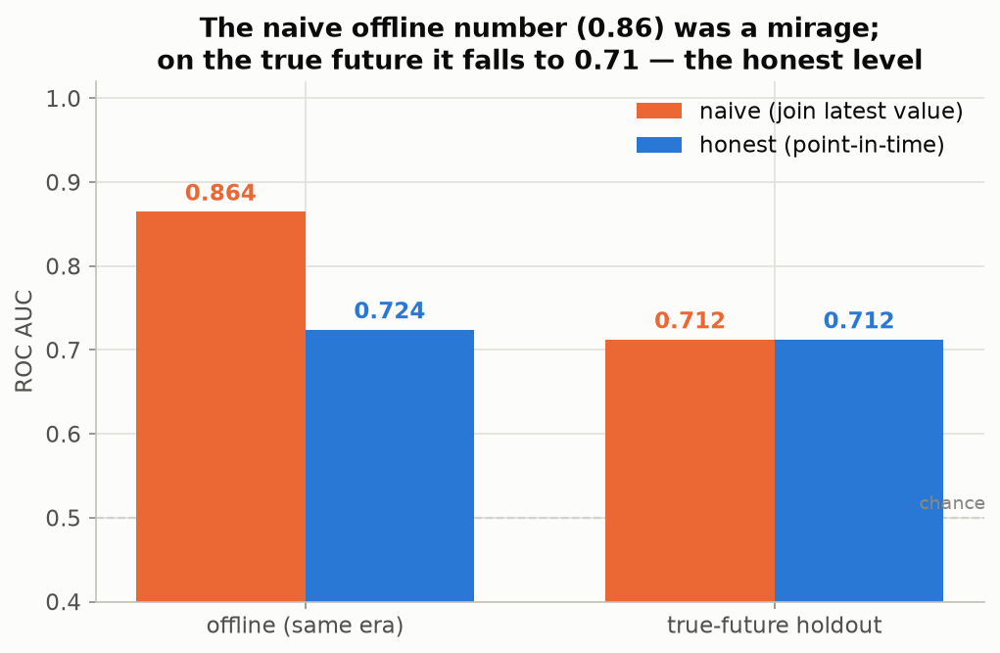
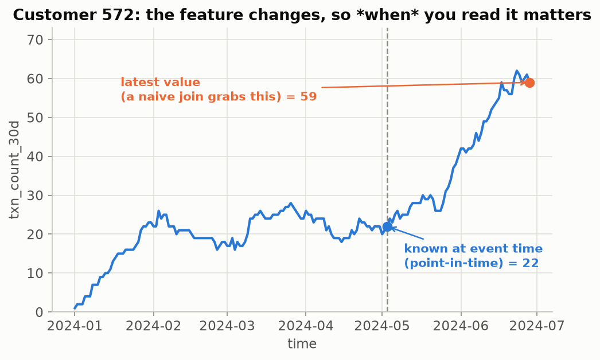
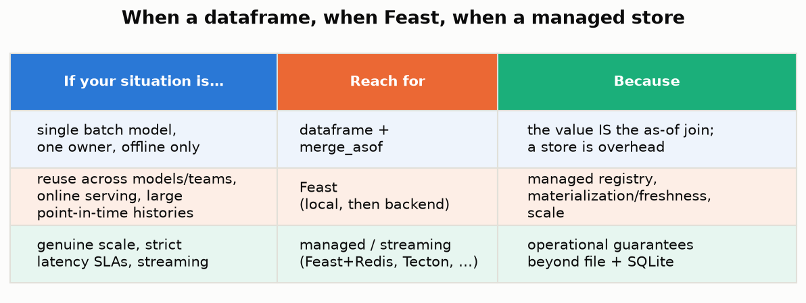

# feature_store_101

**Your training data peeked at the future, and this is how you stop it.**

A hands-on introduction to **feature stores** — the piece of ML infrastructure everyone
name-drops and few can explain — built from scratch on CPU with **no server, no Docker, and no
account**. The whole project runs in a 2-CPU / 8 GB GitHub Codespace.

> A feature store is **one feature definition served two ways**: historically for training
> (point-in-time correct) and latest for serving (fast online lookup), backed by a shared
> registry. It solves **time** and **consistency**, not storage.

`Python 3.12` · `uv` · `pandas` + `scikit-learn` + stdlib `sqlite3` · `feast` (local, optional) ·
CPU-only · Apache-2.0

---

## The claim, in one chart

Take a simple problem: predict a label from a customer's transaction count in the last 30 days.
Build the training set the way most people do — join each customer's **latest** feature value
onto every historical label — and the offline AUC looks great. Build it the **correct** way —
a point-in-time join that gives each label only what was known at its event time — and the
honest number is a dozen points lower. The gap is **leakage, not skill**: score both on a true
future the models never saw and the naive one collapses to the honest level.



The naive offline **0.864** was a mirage. On the true future it falls to **0.712** — exactly
where the honest model sat all along.

---

## The two problems a feature store solves

| Problem | What goes wrong | The fix |
|---|---|---|
| **Point-in-time correctness** | You join the *latest* feature value onto an old label, leaking everything that happened after it. Offline AUC inflates; production collapses. | An as-of join (`pandas.merge_asof`) that fetches the value known **at or before** the event time — never after. |
| **Train/serve consistency** | The feature is implemented twice (a different window, null rule, rounding). The two drift; the model is served inputs it never trained on. | **One shared definition**, materialized from the offline store to the online store, so the served value descends from the trained one. |

The feature at a glance — the value *changes*, so **when** you read it matters:



---

## The results, measured (not asserted)

Everything is computed against planted ground truth on a seeded synthetic stream and asserted
in the test suite.

| Result | Number |
|---|---|
| Naive offline AUC (inflated) | **0.864** |
| Honest point-in-time AUC | **0.724** |
| Naive AUC on the true-future holdout (collapses) | **0.712** |
| Honest AUC on the true future (holds) | **0.712** |
| Train/serve skew: rows where two windows disagree | **96%** |
| Skew cost — ROC AUC slip (hides it) vs accuracy slip (the damage) | **0.02** vs **0.13** (0.672 → 0.543) |
| From-scratch store vs local Feast (200 rows) | **identical**, max │diff│ = 0 |
| The whole from-scratch store | **114 statements of logic** |

---

## What's inside

Six notebooks build the idea up from the mental model to the decision framework. Each imports
from `src/`, runs in well under 5 minutes, and saves its figures to `outputs/figures/` and its
numbers to `outputs/json/`.

| # | Notebook | What it shows |
|---|---|---|
| 01 | [What a Feature Store Is](notebooks/01_what_a_feature_store_is.ipynb) | The two problems and three parts — the mental model, no tool yet. |
| 02 | [Point-in-Time From Scratch](notebooks/02_point_in_time_from_scratch.ipynb) | The leak, measured: naive vs point-in-time, offline vs true future. |
| 03 | [Build a Store in 100 Lines](notebooks/03_build_a_store_in_100_lines.ipynb) | Assemble registry + offline + online + materialize into the two store methods. |
| 04 | [Train/Serve Skew](notebooks/04_train_serve_skew.ipynb) | The same feature computed two ways; AUC hides it, accuracy exposes it. |
| 05 | [Feast Locally](notebooks/05_feast_locally.ipynb) | The real tool, keyless and local, producing identical point-in-time results. |
| 06 | [Decision Framework](notebooks/06_decision_framework.ipynb) | Dataframe vs Feast vs managed — and the rule that outranks the tool. |

---

## The feature store in ~100 lines

The entire from-scratch store ([`src/ministore/`](src/ministore/)) is ~114 Python statements:

- [`registry.py`](src/ministore/registry.py) — entity + feature definitions (the shared catalog)
- [`offline.py`](src/ministore/offline.py) — timestamped history + the point-in-time join
- [`online.py`](src/ministore/online.py) — latest-value key-value store (SQLite)
- [`materialize.py`](src/ministore/materialize.py) — push latest offline values → online
- [`store.py`](src/ministore/store.py) — `get_historical_features` + `get_online_features`

The heart of it is one line — the as-of join that makes a training set honest:

```python
pd.merge_asof(
    requests.sort_values("event_timestamp"),     # (customer_id, event_timestamp)
    history.sort_values("event_timestamp"),       # timestamped feature values
    on="event_timestamp", by="customer_id",
    direction="backward",                          # value at or before the event time; never after
)
```

---

## Quickstart

```bash
make setup       # install deps with uv, register the Jupyter kernel
make data        # generate the seeded synthetic streams -> data/
make test        # run the test suite (point-in-time, leakage, online, parity, skew)
make notebooks   # execute all six notebooks headless
make run         # launch the Streamlit explorer on :8501
make ci          # what CI runs: sync + lint (ruff + ty) + test
```

Everything runs through `uv`. Feast is an optional extra (`uv sync --all-extras`) used only in
notebook 05; the core project and tests run without it.

### Streamlit explorer

`make run` opens four panels, all driven by the same `src/` library: a **time-travel explorer**
(point-in-time vs latest), a **leakage meter**, an **online lookup**, and a **from-scratch vs
Feast** parity check.

---

## Repository layout

```
src/
  ministore/        the from-scratch feature store (~100 lines)
  features/         the one shared feature definition (training AND serving)
  feast_demo/       local Feast repo + programmatic driver (no server, no account)
  datasets/         seeded, planted-truth synthetic event stream
  evaluation/       leakage · skew · parity · comparison harness
  artifacts.py      save figures (PNG) and results (JSON), validated palette
notebooks/          01–06
app/streamlit_app.py
tests/              point_in_time · naive_leaks · online · parity · skew
outputs/            figures/*.png + json/*.json (the deliverables the article cites)
config/settings.yaml
```

---

## Decision framework



And the rule that outranks the tool choice:

> **You may not need a feature store, but you always need point-in-time correctness and
> train/serve consistency. If you skip the store, do not skip the discipline.**

---

## Related projects

Part of a series of from-first-principles data-science projects by
[@Dima806](https://github.com/Dima806):

| Project | How it connects |
|---|---|
| [cv_arena](https://github.com/Dima806/cv_arena) | The five ways cross-validation silently inflates your score — the single-model version of the leak-safe discipline a feature store enforces at scale. |
| [feature_engineering_arena](https://github.com/Dima806/feature_engineering_arena) | Feature-engineering transforms measured where the signal is planted in a form the raw feature hides — the features a store serves. |
| [model_drift_detector](https://github.com/Dima806/model_drift_detector) | Drift detection for ML models — feature freshness and staleness are the serving-side of the same concern. |
| [timeseries_101](https://github.com/Dima806/timeseries_101) | What makes time-ordered data different — the temporal thinking behind point-in-time correctness. |
| [metrics_101](https://github.com/Dima806/metrics_101) | ROC AUC, log loss, and friends from a confusion matrix up — the metrics this project measures the leak with. |
| [calibration_arena](https://github.com/Dima806/calibration_arena) | Five probability-calibration methods — why AUC can look fine while accuracy at the threshold slips (notebook 04's lesson). |

---

## License

[Apache-2.0](LICENSE).
